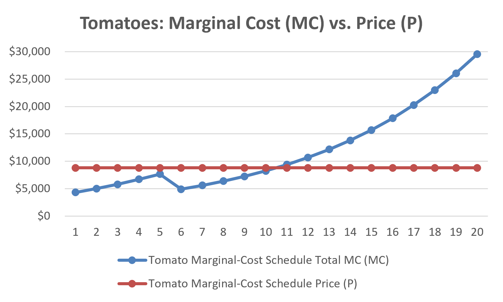
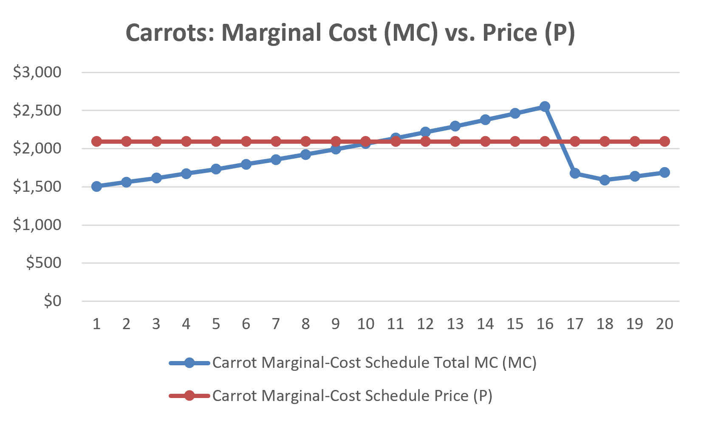
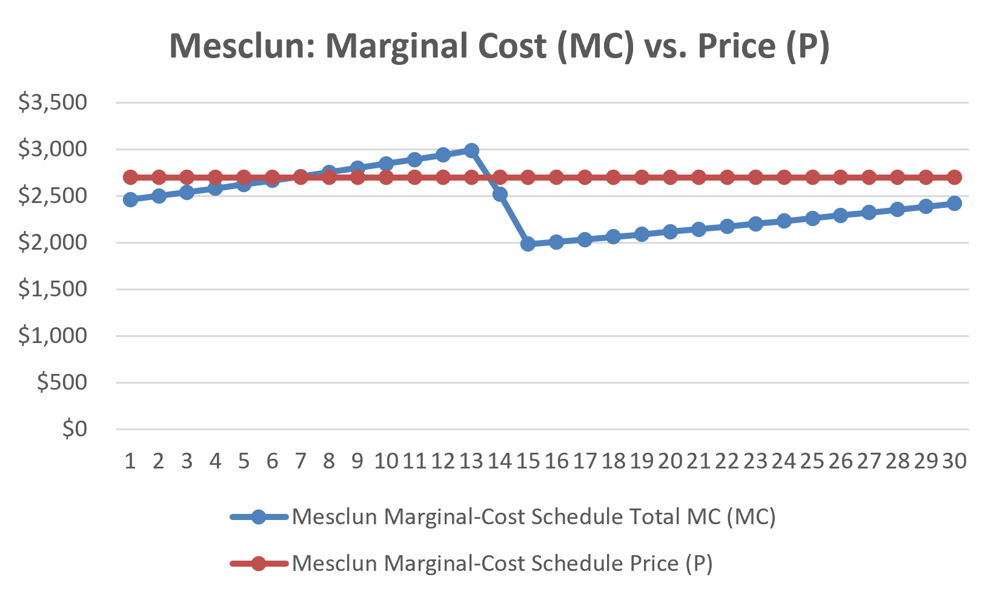

# Perfect Competition Analysis

## 1. Price and Marginal Cost
In a perfectly competitive market, the farm is a price taker. Since the farm decides production by the number of beds, the main rule is to keep adding beds as long as the market price is equal to or higher than marginal cost, or **P >= MC**. The farm should stop adding beds when **P < MC**.
*Figure 1: Marginal Cost Curves (MC) and Market Price (P) for Each Crop*

* **Tomato (P = $8,800 per bed):**
  * **Bed 10:** MC = $8,248.11. Since P >= MC, this bed gives a marginal profit of **+$551.89**.
  * **Bed 11:** MC = $9,390.17. Since P < MC, this bed causes a loss of **-$590.17**.
  * **Decision:** The farm should stop tomato production at **10 beds**.

* **Carrot (P = $2,094 per bed):**
  * **Bed 20:** MC = $1,688.37. Since P >= MC, this bed still gives a marginal profit of **+$405.63**.
  * **Bed 21**: MC = $1,740.90. Since P > MC ($2,094), this additional bed increases profit by **$353.10**.
  * **Decision:** The farm should produce up to the maximum limit of **20 beds**.

* **Mesclun (P = $2,700 per bed):**
  * **Bed 30:** MC = $2,420.00. Since P >= MC, this bed still gives a marginal profit of **+$280.00**.
  * **Bed 31:** MC = $2,453.43. Since P > MC ($2,700), this additional bed increases profit by **$246.57.**
  * **Decision:** The farm should produce up to the maximum limit of **30 beds**.

Therefore, the optimal crop mix for the whole farm is **10 / 20 / 30, for a total of 60 beds**.

---

## 2. Binding and Slack Constraints & Shadow Prices
Under the optimal crop mix of **10 / 20 / 30**, the farm has the following constraints:
* **Total Land Capacity (64 beds):**
  * The farm uses 60 beds, so 4 beds remain unused.
  * This is a **slack constraint**, and the shadow price is **$0**.

* **Total Labor Capacity (6,480 hours):**
  * The farm uses 5,276.82 hours, so 1,203.18 hours remain unused.
  * This is also a **slack constraint**, and the shadow price is **$0**.

* **Carrot Capacity Constraint (20 beds):**
  * This constraint is **binding**.
  * If the carrot limit increases from 20 to 21 beds, the MC of Bed 21 is $1,740.90.
  * The additional profit is **+$353.10 per bed** because $2,094 - $1,740.90 = $353.10.

* **Mesclun Capacity Constraint (30 beds):**
  * This constraint is also **binding**.
  * If the mesclun limit increases from 30 to 31 beds, the MC of Bed 31 is $2,453.43.
  * The additional profit is **+$246.57 per bed** because $2,700 - $2,453.43 = $246.57.

* **Tomato Capacity Constraint (20 beds):**
  * This constraint is **slack** because the farm stops at 10 beds for economic reasons.

---

## 3. Marginal Cost Curves & Labor Shift
The marginal cost curves are affected by diminishing returns and the two labor rates. The owner rate is **$34.72 per hour** for the first 720 cumulative labor hours, and the temporary worker rate is **$17.36 per hour** after that.
*Figure 2: Labor Hour Allocation and MC Change After Reaching the 720-Hour Owner Cap*

* **Bed 5 Labor Shift:**
  * Total labor reaches 527.08 hours at Tomato Bed 4 and 724.73 hours at Bed 5.
  * Bed 5 requires 197.65 labor hours.
  * This means Bed 5 uses the remaining **192.92 owner hours at $34.72/hr** and **4.73 temporary worker hours at $17.36/hr**.
  * With the $880 fertilizer cost, the marginal cost of Bed 5 is **$7,660.43**.

* **From Bed 6:**
  * Starting from Bed 6, all extra labor is paid at the temporary worker rate of $17.36/hr.
  * Bed 6 requires 231.91 labor hours.
  * Because the labor rate becomes lower, the marginal cost falls to **$4,906.02**.

---

## 4. Standalone Profitability & AVC Comparison

The table below shows the standalone profitability of each crop, including the fixed overhead of $20,000. It also compares Market Price (P) with Average Variable Cost (AVC).
*Figure 3: Standalone Profitability and AVC vs. Market Price*

| Crop | Standalone Beds | Revenue | Variable Cost (VC) | Average Variable Cost (AVC) | Market Price (P) | Contribution Margin (CM) | Fixed Overhead | Standalone Net Profit |
|---|---:|---:|---:|---:|---:|---:|---:|---:|
| **Tomatoes** | 10 beds | $88,000.00 | $61,823.83 | **$6,182.38** | $8,800.00 | +$26,176.17 | $20,000 | **+$6,176.17** |
| **Carrots** | 20 beds | $41,880.00 | $38,360.20 | **$1,918.01** | $2,094.00 | +$3,519.80 | $20,000 | **-$16,480.20** |
| **Mesclun** | 30 beds | $81,000.00 | $72,919.21 | **$2,430.64** | $2,700.00 | +$8,080.79 | $20,000 | **-$11,919.21** |

### Economic Interpretation & Shutdown Condition
1. **Shutdown Condition (P > AVC):**
   * For all three crops, P > AVC.
   * This means each crop can cover its variable costs and has a positive contribution margin.

2. **Standalone Profitability vs. Multi-Crop Optimization:**
   * **Tomatoes** have a contribution margin of +$26,176.17. This is enough to cover the $20,000 fixed cost, so tomatoes alone make a net profit of **+$6,176.17**.
   * **Carrots** and **Mesclun** also have positive contribution margins, but they are not enough to cover the full $20,000 fixed cost by themselves. Therefore, they have standalone losses.
   * **Conclusion:** When all three crops are combined in the optimal mix of **10 / 20 / 30**, their contribution margins are combined. This allows the farm to cover the $20,000 fixed cost and earn the maximum net seasonal profit of **$42,775.16**.

---

## 5. Stage 1 Hypothesis vs. Results
### Hypothesis Evolution & Verification
* **Initial Hypothesis (20 / 20 / 24):**
  * This plan focused on maximizing revenue.
  * However, it requires **14,547 labor hours**, which is more than double the labor limit of 6,480 hours.
  * It is therefore not feasible.
  * Also, Tomato Beds 11-20 create large losses.

* **Revised Brief Hypothesis (13 / 20 / 24):**
  * This plan reduces labor use to 6,477 hours, which is just under the 6,480-hour limit.
  * However, Tomato Beds 11-13 still lose money.
  * For example, Bed 13 has **MC = $12,158.01**, which is higher than **P = $8,800**.

* **Final Optimal Model (10 / 20 / 30):**
  * The farm stops tomato production at **10 beds**, before P becomes lower than MC.
  * This also frees 1,203 labor hours.
  * The farm can then use more resources for profitable mesclun production up to 30 beds.
  * As a result, the farm earns the maximum net seasonal profit of **$42,775.16** while using only 5,276.82 labor hours.
